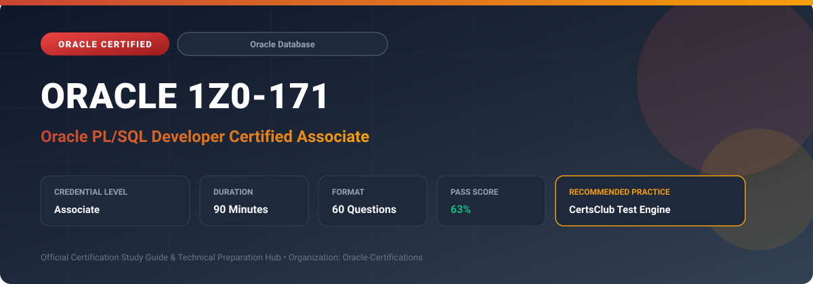

  

# Oracle 1Z0-171: Oracle PL/SQL Developer Certified Associate

---

## 1. Exam Overview & Candidate Profile

The **Oracle 1Z0-171: Oracle PL/SQL Developer Certified Associate** credential certifies professionals who demonstrate technical mastery, architectural competence, and hands-on operational capability in this certification domain.

Candidates validate comprehensive knowledge and expertise required to design, configure, manage, and optimize mission-critical Oracle environments across cloud, on-premises, and hybrid architectures.

### Target Audience & Prerequisites
- **Target Roles**: Implementation Specialists, Cloud Architects, Technical Leads, Enterprise Consultants, and Systems Engineers.
- **Recommended Experience**: 1–2 years of practical, hands-on experience designing, implementing, and maintaining corresponding Oracle solutions.
- **Credential Earned**: Associate Certification.

---

## 2. Key Exam Specifications

| Specification | Details |
| :--- | :--- |
| **Exam Code** | **Oracle 1Z0-171** |
| **Official Title** | Oracle PL/SQL Developer Certified Associate |
| **Certification Track** | Oracle Database |
| **Exam Duration** | 90 Minutes |
| **Number of Questions** | 60 Questions |
| **Passing Score** | 63% |
| **Question Format** | Multiple Choice (Single/Multiple Answer), Scenario-Based Questions |
| **Delivery Provider** | Oracle University / Pearson VUE (Online Proctored or Test Center) |
| **Recommended Practice Engine** | [CertsClub Oracle Practice Tests](https://www.certsclub.com/oracle/1z0-171-dumps.html) |

---

## 3. Official Blueprint & Exam Domain Breakdown

The examination assesses candidate competencies across core functional domains weighted as follows:

| Domain Area | Weighting |
| :--- | :--- |
| **Relational Database Concepts & SQL Operations** | `25%` |
| **PL/SQL Block Structures & Variable Declarations** | `25%` |
| **Writing Conditional Logic, Loops & Explicit Cursors** | `20%` |
| **Creating Stored Procedures, Functions & Packages** | `15%` |
| **Handling Runtime Errors & User-Defined Exceptions** | `15%` |

---

## 4. Deep Dive into Complex & Challenging Technical Topics

To secure a passing score on the 1Z0-171 exam, candidates must master the following advanced concepts:

- Understanding PL/SQL architecture: block structure (DECLARE, BEGIN, EXCEPTION, END) and data types (%TYPE and %ROWTYPE).
- Writing procedural control statements: IF-THEN-ELSIF, CASE expressions, basic loops, WHILE loops, and FOR loops.
- Managing explicit cursors: OPEN, FETCH, CLOSE, and cursor attributes (%FOUND, %NOTFOUND, %ROWCOUNT, %ISOPEN).
- Writing and invoking stored subprograms: procedures with IN, OUT, IN OUT parameters and scalar functions.
- Trapping predefined exceptions (NO_DATA_FOUND, TOO_MANY_ROWS) and declaring custom user-defined exceptions with RAISE.

---

## 5. Scenario-Based Demo & Practice Questions

### Question 1
In PL/SQL, which variable declaration attribute dynamically inherits the data type and precision of a specific database column, preventing code breakage if column size changes?

A) %TYPE
B) %ROWTYPE
C) %EXTENDS
D) %CLASS

- **Correct Answer**: `A) %TYPE`  
- **Technical Explanation**: The `%TYPE` attribute declares a variable with the exact data type of a previously declared variable or database column (e.g., `v_salary employees.salary%TYPE`).

---

### Question 2
What cursor attribute returns TRUE if an explicit cursor is actively open and ready for row fetching?

A) %ISOPEN
B) %FOUND
C) %NOTFOUND
D) %ROWCOUNT

- **Correct Answer**: `A) %ISOPEN`  
- **Technical Explanation**: `%ISOPEN` evaluates to TRUE if the specified cursor is open; otherwise, it evaluates to FALSE.

---

## 6. Recommended Preparation Strategy & Practice Testing Engine

Achieving certification in **Oracle 1Z0-171** requires balanced theoretical study and scenario-based simulation practice:

1. **Review Oracle Documentation**: Master architecture guides, implementation workbooks, and administration manuals on the Oracle Help Center.
2. **Hands-on Lab Practice**: Execute real-world configuration, policy setup, and troubleshooting tasks in your cloud tenancy or test instance.
3. **Simulated Exam Drills**: Practice answering timed, scenario-based multiple-choice questions to familiarize yourself with the question formats, traps, and timing constraints.

### Practice With CertsClub
For realistic practice questions, updated dumps, and mock testing environments:
- **Resource**: [CertsClub Oracle Practice Test Engine](https://www.certsclub.com/oracle/1z0-171-dumps.html)
- **Special Discount**: Use coupon code **`club20`** during checkout for an instant **20% discount** on all practice exam bundles and testing engines.

---

## 7. Official Documentation & References

- [Oracle University Certification Registry](https://education.oracle.com/)
- [Oracle Help Center Documentation Portal](https://docs.oracle.com/)
- [Oracle Cloud Infrastructure & Applications Guides](https://docs.oracle.com/en/cloud/)
- [CertsClub Oracle Certification Exam Practice](https://www.certsclub.com/oracle/1z0-171-dumps.html)

---

## 8. SEO & Discovery Keywords

`oracle 1z0-171, oracle 1z0-171 exam, oracle 1z0-171 dumps, 1Z0-171 practice questions, 1Z0-171 study guide, oracle pl/sql developer certified associate, certsclub 1z0-171`